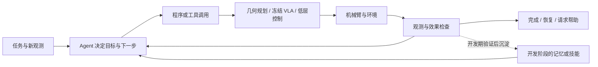

# 机械臂 Embodied Agent：从选技能到积累可执行经验

核查截止：2026-10-30。本文基于本项目已有文献表、专题资料、用户知识库及本目录 21 篇固定版本预印本。论文贡献在各篇解读中注明；下文的阶段划分、联系与研究判断是整理者的分析，不能理解为每篇论文都直接继承上一篇。

## 先把我们现在的位置说清楚

当前本地 Agent 核心来自上游 **RPent / Harness VLA**。观察目标、预定位、换指令和失败后重抓，上游提示词、原语与记忆已经包含相关能力；本地启动、环境适配、监控和原生结果检查，使这套系统能在当前环境运行。这些工作有工程价值，但不能据此称已原创一个 Agent 算法。未提交适配的具体作者尚不能从独立 Git 历史确认，也没有完成全部文件与原始归档的逐项比对。来源背景可对照 已有 Harness VLA 笔记（本地来源，未发布） 和 [本次原文解读](../../../papers/arxiv-2607.08448/reading-2026-10-30.md)。

项目此前已有两类运行证据：官方 `pi05_libero` 在 LIBERO-Spatial 的 10 个任务各跑一次，得到 10/10；RPent 配合 RLinf π0.5 SFT 权重，在 LIBERO-Pro/object_swap/task2、seed 0 有一回合成功，过程中出现观察、预定位和滑落恢复。这证明相关链路可以工作；权重、任务、扰动与回合数不同，不能据此算出“Agent 相对 VLA 提升多少”，更不能把单回合外推到整个 benchmark。本次只整理文献，未新增这些运行结果。

因此，接下来最值得问的是：同一动作底座、同一工具和预算下，Agent 的在线判断究竟增加了什么？它是在绑定正确目标、改善动作前条件、从失败中恢复，还是读取了探索阶段已保存的经验？这个问题比再寻找一个演示效果最好的系统更有研究价值。

## “Agent”“代码策略”和“VLA”不是同一层

这里把机械臂 Agent 理解为一个持续根据观测与执行结果组织行动的系统。它可以调用 VLA，也可以生成程序调用几何控制器；可以包含学习过的模型，也可以只在推理时组合已有能力。判别重点是**谁决定下一步、得到什么反馈、以什么证据停止，以及经验怎样影响之后的任务**。

| 层次 | 输入与输出 | 机械臂例子 | 常见误读 |
|---|---|---|---|
| 高层任务决策 | 指令、场景、历史 → 子任务、工具选择或程序 | 判断先移开遮挡物，还是重新抓碗 | 将语言解释本身当作可靠状态估计 |
| 程序/技能执行 | 参数、当前观测 → 一段有条件的动作过程 | 对齐碗沿，检查夹爪，再搬运 | 只要输出代码就必定闭环 |
| 连续动作策略/规划 | 图像或几何状态 → 动作 chunk、轨迹、目标位姿 | VLA 处理接触，规划器处理自由空间 | 将 VLA 等同于完整 Agent |
| 低层控制 | 目标与反馈 → 可执行的关节/执行器命令 | IK、轨迹跟踪、限速与碰撞约束 | LLM 写了位姿，就等于它直接实时输出电机力矩 |

这几层的时间尺度不同。伺服器需要快速稳定地闭环；程序可以反复查询传感器并执行局部逻辑；Agent 通常在原语完成、失败或情况不明时重新推理。让低层等待推理在某些仿真和静态真机任务中可行，但不能自动推广到有人或物体持续运动的场景。[Code as Policies](../../../papers/arxiv-2209.07753/reading.md)、[VoxPoser](../../../papers/arxiv-2307.05973/reading.md)、[Agent as Policy](../../../papers/arxiv-2609.12541/reading.md) 展示的是不同分工。

以“把蓝碗放到盘子上”为统一教学例子，完整过程应能回答：蓝碗由图像还是特权状态定位；取物前姿态怎样确定；抓取调用 VLA 还是规划抓取；抬升后以什么信号判定抓住；滑落时是否重新观察；放置后谁判定任务完成。下面的图是分析框架，不是某篇论文的原图，也不表示所有论文都具备全部模块。

## 2022：从“说下一步”走向“下一步做得到，并且知道做没做到”

[SayCan](../../../papers/saycan/reading-2026-10-30.md) 的关键是将语言上有用的技能，与当前状态下技能成功的可行性结合。LLM 负责“应该做什么”，已训练的技能与价值函数负责“当前是否做得到”。技能库决定了系统的动作边界；语言表达变丰富不会自动产生新的抓取能力。

[Inner Monologue](../../../papers/arxiv-2207.05608/reading.md) 把成功检测、场景描述和问答回传语言上下文，使后续决策不只依赖“我发出过什么命令”。抓碗失败后重新抓，与在计划列表里把抓碗标成完成，是两种不同系统。论文某些条件使用 oracle 场景信息或人回答，不能把所有结果当作完全自主视觉闭环。

[Code as Policies](../../../papers/arxiv-2209.07753/reading.md) 则改变了高层输出的表达能力：从选择技能，扩展到 Python 中的循环、条件、几何计算和组合函数。程序能够重复读观测，因此 CaP 并非天生开环；是否闭环取决于实际生成的代码及接口。与此同时，[ProgPrompt](../../../papers/arxiv-2209.11302/reading.md) 用动作、对象与断言约束计划，展示前提检查和恢复。不过其 VirtualHome 断言机制不能直接移植为论文 Panda 真机的事实：该真机演示未实现断言闭环。

这一阶段留下两类问题：技能/API 内部隐藏了多少机器人能力；语言或程序看到的反馈是否足够可信。它们到 2026 年仍然存在。

## 2023–2024：把语义落到可执行的几何关系

单纯写“抓住蓝碗”不解决坐标、姿态、避障与连续动作。[VoxPoser](../../../papers/arxiv-2307.05973/reading.md) 让语言生成构造三维 value map 的程序，由视觉把对象绑定到空间，再由规划器优化末端轨迹。每个子任务的代码可以缓存；新观测重建地图并用 MPC 重规划，不需要每个控制周期重新请求 LLM。这里的 value map 是空间目标，与 SayCan 的技能成功价值不是一个对象。

[ReKep](../../../papers/arxiv-2409.01652/reading.md) 用关键点关系进一步表达约束，例如保持物体方向、让两个点靠近、沿路径维持某种关系。模型生成的是点到代价的约束函数，优化器负责求动作，跟踪系统让约束随观测更新。这并不等于模型已经学会任意物理交互：原文依赖关键点局部刚性假设，遮挡跟踪是主要失败因素，阶段骨架相对固定，也未研究任意关节物体操作。

这些方法的共同启发是：可以让通用模型负责可解释的目标结构，把连续求解交给成熟算法。代价转移到了可靠感知、几何建模与控制接口。它们与 VLA 路线长期并行，不是被 VLA 出现后整体取代。[奖励代码、监控代码等邻近分支](扩展阅读与边界.md) 也应按其作用位置理解。

## 2025：更强的动作底座，与可累积的程序经验

[π0.5](../../../papers/arxiv-2504.16054/reading.md) 代表动作模型路线：通过数据与训练，把视觉、语言、子任务推理和动作生成结合起来，增强跨场景操作能力。VLA 让接触丰富操作有了可调用底座，但模型能力仍受数据与部署分布影响。原始 π0.5 论文、官方 LIBERO checkpoint 与 RLinf 的 LIBERO SFT 权重，必须分开记录。

[LYRA 的 2025 年 v2](../../../papers/arxiv-2509.18597/reading.md) 展示另一种“成长”：人类纠错帮助修改代码技能，记忆与检索支持复用，不是持续更新网络权重。它依赖的仿真对象位姿/尺寸、实机 CAD 与 FoundationPose，以及人反馈轮数，都是系统条件。与单次 CaP 相比的结果，不能改写为同预算下无人自主提升。

这两条路线改变的东西不同：VLA 将经验写进参数，LYRA 将经验写进可读代码与库。之后的 Agent 系统可以组合它们。保存 v2 是为了讲清 2025 年证据；当前 v3 已改题和实验，本库没有将新版结果倒填到早期阶段。

## 2026：从一个模型，转向完整运行系统的能力分配

### 程序怎样试、怎样改、怎样交付

[Act-Observe-Rewrite](../../../papers/arxiv-2603.04466/reading.md) 在回合之间依据图像、日志与结果重写控制程序；其证据是三个 robosuite 任务，不是通用真机终身学习。[Agent as Policy](../../../papers/arxiv-2609.12541/reading.md) 则让冻结通用 Agent 读机器人文档、利用相机与深度写程序，在真实任务中观察并纠错；低层仍依赖 IK 与运动执行，任务通常需分钟级推理和试验。

[URAI](../../../papers/arxiv-2609.39018/reading.md) 研究工具构建与执行决策的分工；[OpenRUA](../../../papers/arxiv-2610.02459/reading.md) 研究通用 Agent 通过原生机器人接口工作，减少专门为 Agent 设计的动作抽象。“原生接口”仍有 ROS、驱动和控制器提供能力。它们提示一个问题：性能提高来自模型更会决策，还是接口把更多工作提前做好了？

[CaP-X](../../../papers/arxiv-2603.22435/reading.md) 与 [CodeActionBench](../../../papers/arxiv-2609.33807/reading.md) 因而值得和方法论文一起读。前者系统改变控制抽象、感知输入、反馈和训练条件；后者固定任务与交互协议，区分最终成功和任务覆盖。跨论文成功率往往混有不同模型、工具、重试、任务与观测权限，不能只比较一列数字。

### 冻结 VLA 之外，谁负责让它更容易成功

[Harness VLA](../../../papers/arxiv-2607.08448/reading-2026-10-30.md) 用固定解析原语完成定位、预对位、搬运和释放，把冻结 VLA 用在适合的局部接触阶段。Agent 与记忆负责选择顺序、重新绑定目标和恢复。任务开始前的 reference 探索可 reset 并形成记忆；正式评估禁止 reset。论文中的“冻结”指运行中不改 VLA 参数，不代表它从未训练，或系统没有开发期试错成本。

[HELM](../../../papers/arxiv-2604.18791/reading.md) 将记忆与可执行性验证引入动作选择，但验证器需要训练。它说明“冻结 VLA”与“整个系统无训练”是两回事。现有 RPent 工程最接近这一大类：先改善目标与动作前条件，再执行和检查，而不是立即把一切问题归为 VLA 需要更大规模训练。

### 一次执行结束后，留下什么

[RoboSkill](../../../papers/roboskill/reading-2026-10-30.md) 保存文本、实际代码、关键帧与元数据，探索与执行循环帮助之后调用；同任务技能复用、跨 Agent 复用与跨任务迁移必须区分。其仿真每单元可多回合、数小时探索，不能把最终成功率当成首回合能力。

[ASPIRE](../../../papers/arxiv-2607.00272/reading.md) 更强调失败证据：逐原语记录、诊断、修改、调试种子复测，再由 verifier 验证，形成带适用条件的修复技能。调试集上的修好不等于留出评估成功，开发与测试信息应隔离。

[RAX](../../../papers/arxiv-2610.22496/reading.md) 进一步把较长探索整理成可重算的程序。程序在新场景重新感知、建模和规划，超出适用条件时可在 Agent-in-loop 模式交回决策层。其 fully automated program 模式不让主 coding agent 临场编辑和重试，但程序仍可调用辅助 VLM；真实系统还有操作员复位等支持。示范条件也因基准而异：HumanoidArena 主结果使用每任务三条含动作遥操作示范，去掉动作是另一个、探索预算更大的消融。“编译后独立执行”“不更新大模型参数”和“完全无人工/无示范/无模型调用”不能混为一谈。

### 真正更新参数时，更新谁

[AgenticRoboRL](../../../papers/arxiv-2610.28589/reading.md) 固定感知、规划与 VLA，SFT 后用交互结果训练高层 planner。RPent 教师可用记忆，学生评估不外接记忆；这不抹去教师经验通过训练数据的作用。论文主要是仿真证据，CaP-X 分支重新训练且使用特权状态，不能理解为一个 RPent checkpoint 无条件跨系统迁移。

[ENPIRE](../../../papers/arxiv-2606.19980/reading.md) 让 Agent 组织真实机器人策略改进：先有人参与搭建并固定安全、reward、reset 等接口，再试验程序策略或训练算法。这里 Agent 是研究与实验的组织者，机器人策略可以训练。其核心条件是可靠可重复的实验闭环，不能仅因为用了大模型就忽略复位、奖励准确性和人工支持。

## 用三个维度理解并行路线

| 路线 | 谁主要决定下一步 | 经验写在哪里 | 典型代价或边界 |
|---|---|---|---|
| 技能语言规划 | LLM 选择已有技能 | 技能模型、语言历史 | 技能库覆盖与反馈可靠性；SayCan / Inner Monologue |
| 代码与空间约束 | 生成程序，解释器/优化器执行 | 程序、约束、几何参数 | 感知/坐标/控制 API；CaP / VoxPoser / ReKep |
| VLA 外层 Agent | Agent 选工具与接触原语 | 外部记忆、恢复规则 | 同工具 FSM、公平预算；Harness VLA / HELM |
| 技能与程序积累 | 探索 Agent，后续调用技能/程序 | 代码、失败证据、适用条件 | 开发成本与测试隔离；LYRA / ASPIRE / RoboSkill / RAX |
| 规划器后训练 | 训练后的工具规划模型 | planner 参数 | 训练轨迹、奖励与泛化范围；AgenticRoboRL |
| Agent 组织策略研发 | Agent 选择实验与改动 | 程序及机器人策略参数 | 真机复位、安全、奖励可靠性；ENPIRE |

这不是从低到高的成熟度排名。例如强 VLA 与可解释程序可以互补；程序库成熟后，运行时反而可以减少昂贵的 Agent 推理。对我们更有用的目标，是让常见任务段稳定执行，让不确定性触发恰当的观察、恢复或求助，并能解释提升来自哪一层。

## 当前项目最小可检验的问题

优先固定同一 RLinf π0.5 checkpoint、任务集合和工具，比较直接 VLA、相同工具的固定 FSM、冻结通用 Agent。先拆出“正确目标绑定”“预定位”“失败恢复”“外部记忆”四种收益，不急于同时换模型、增加工具、修改记忆并训练 planner。随后再考虑把稳定流程整理为可重算程序，或训练小 planner。[具体对照与停止条件](研究选项与公平对照.md) 已单列，本次未实施。

未来研究是否有价值，应看留出初态和新扰动中的收益、完整任务成功、失败识别与总成本，而不只看一次漂亮演示。能证明一个更小但清楚的增量，比把上游已有能力重新命名为自研 Agent 更可靠。
