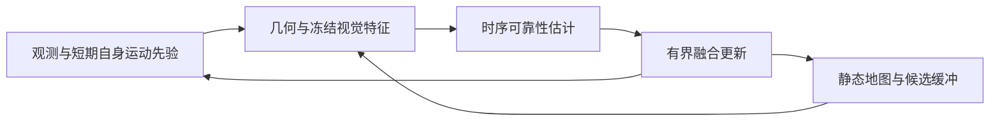

# 动态语义与学习辅助融合 SLAM 研究总结与开工方案

> 以动态鲁棒 LIVO 前端为起点
>
> 技术方案  2026 年 10 月 31 日

[返回定位与建图](README.md) · [基线](BASELINES.md) · [文献目录](PAPERS.md)

**建议把首个项目收敛为一个可反证的问题：当机器人自身运动预测受损，同时场景里存在独立运动物体时，能否更准确地判断哪些观测仍然可信，并比简单鲁棒方法更稳定地估计自身运动？** 视觉是主要研究入口，LiDAR 提供稀疏有尺度几何，IMU 提供短期运动先验。目标不是单独调大 IMU 协方差，也不是一开始完成全场景语义重建。

建议保留 FAST-LIVO2 或已验证的 LIVO 工程骨架，先做可回放数据、强非学习对照和冻结视觉特征的小型可靠性头。MVP 只学习进入更新的静态支持或观测可靠性，保持物理噪声模型固定，不同时自由学习多个等效降权量。只有前一阶段证明有净收益，再增加时序耦合、短窗可微训练或可选支路。这是一份研究设计与执行门槛，不代表模块已经实现，也不预先认定新颖性。

### 现在应做的三项决定

- **首个研究对象是观测可靠性与自身误差的相互影响。** 比较几何鲁棒核、相机级调权、语义掩码与状态条件可靠性，而不是比较谁堆叠的模型最多。
- **训练采用离线仿真记录和短窗口回放。** 长轨迹采集一次，再切窗、缓存固定量；训练不同时运行仿真。最终评估仍须连续运行完整轨迹，不能每窗用真值重置。
- **工程改造由测量决定。** 先 profile，再考虑 GPU 批量投影、残差和雅可比；小状态求解、地图查询与增删不保证迁移受益。

### 第一阶段的边界

第一版包含 M0 数据回放、M1 几何特征、M2 一种冻结视觉表征、M3 小型可靠性头、M4 有界融合接入，以及最小静态地图保护。学习型 IMU、控制条件、深度补全、SAM、稠密光流、对象级动态建图、3DGS 和自定义 CUDA 均不是必选项。

**如果初期没有回环与全局优化，成果应称为动态鲁棒 LIVO 前端或局部里程计，不应宣称已经完成完整全局 SLAM。** 静动态地图缓冲也不等于对象运动联合估计或完整 4D 重建。

### 读完后应得到什么

一套可以先小规模验证、失败时能及时停止的模块选择；一份可直接指导数据录制和读取器设计的 schema；一张公平实验矩阵；以及第一周的具体起点。文末给出一手论文与官方代码入口，推荐顺序不要求先复现全部相关系统。

## 开工起点与第一周交付

第一周的目标不是训练出完整系统，而是获得**一条可重复回放的基线轨迹、一份可独立读取的短窗数据包，以及一个确实需要改进的失败案例**。以下是执行建议；实际天数随工程现状调整，阶段验收比日历更重要。

| 时段 | 具体行动 | 可检查的交付 |
| --- | --- | --- |
| 第 1 天 | 锁定基线 commit、配置、传感器输入与时间同步；画出现有状态传播、观测构造和地图更新路径 | 基线清单；一次原始流回放；标明是否有回环和全局优化 |
| 第 2 天 | 记录正常与失败轨迹；按阶段测量读取、传播、匹配、视觉、求解、地图耗时 | 原版准确度、失败日志和 mean/P95/P99 延迟；不先迁移 GPU |
| 第 3 天 | 录制小量仿真长轨迹，保存原始观测、真值与配置；按整轨迹划分数据集 | 一份不可变原始记录；train/validation/test 轨迹清单 |
| 第 4 天 | 实现独立切窗与读取验证；保存起点、历史预热来源和允许缓存的量 | 不启动仿真即可读取、检查并回放窗口；抽样字段审计通过 |
| 第 5 天 | 设置动态与自身误差组合；对照原版、强几何、相机调权与真值运动掩码 | 配对诊断表；oracle 也无收益时，先停下排查而非训练分类器 |

### 第一条具体操作

先选一条现有可回放记录，固定其传感器配置、初始化和评估脚本，保存原版结果与逐阶段计时。**这一步不需要 DINO、SAM、可微滤波或 CUDA。** 如果原版不能稳定复现，先解决接口、同步和评估问题，暂不进入学习实验。

### 开工前必须核清的信息

1. 实际工程是 FAST-LIVO2、FAST-LIO2 加视觉模块，还是本地改造版；相机数、分辨率、频率和地图形式是什么。
2. 现有仿真能否同步记录 RGB、LiDAR、IMU、机器人真值和对象真值；真实记录是否满足评估需要。
3. 若已有学习型惯性模块，其输入输出、坐标系、时间窗，以及不确定性究竟是标准差、协方差还是过程噪声。
4. 可用 GPU、显存、磁盘与实时预算；首先满足哪一种机器人运动和退化场景，而非泛指全部场景。
5. 第一阶段优先定位稳健性还是完整语义建图。后者若成为主目标，需要另行调整问题、基线和里程碑。

## 1 研究问题与可辨识边界

### 1.1 不是先估准自身再识别动态

自身运动错误会使静态世界产生大残差；物体独立运动也会产生大残差。如果先验已经偏离，再把所有大残差都解释成动态，系统可能删除最需要的静态约束。反过来，若把动态物体当成稳定参考，更新又会把自身状态推向错误方向。首个研究问题就是能否缓解这种相互强化。

候选机制是：用几何、视觉和有限历史共同区分全局一致的自身误差模式、局部独立运动，以及观测质量下降；再以有界方式影响融合。要分别验证三个假设：状态条件能减少静态误删，视觉表征提供强几何方法之外的信息，而局部改善能在完整闭环轨迹中保持。该机制是否有效，必须在“动态＋自身预测受损”的组合场景验证，而不能只展示动态分割或单独惯性漂移曲线。

### 1.2 四种量必须分开命名

| 量 | 回答的问题 | 不能直接等同于 |
| --- | --- | --- |
| 独立运动概率 | 观测对象是否偏离静态世界假设 | 语义类别；匹配一定错误；协方差数值 |
| 静态匹配有效性 | 该对应能否约束静态世界中的自身运动 | 物体一定静止；低光度误差 |
| 噪声协方差 | 在指定模型下，测量误差如何分布 | 任意置信度分数；没有单位的权重 |
| 优化或融合权重 | 实际更新中保留多少影响 | 已校准的概率；严格贝叶斯后验 |

例如，停着的车辆可以提供有效静态约束；静态墙面也可能因反光、遮挡或错误深度而无效。降低一个残差的权重是一种工程操作，不能自动证明网络已正确估计其动态概率或噪声分布。

### 1.3 允许未知与不可判定

低纹理、重遮挡、缺少深度或大部分可见物体共同运动时，残差原因可能不可辨识。正确行为可以是保留未知、降低信息量、依靠其他模态或触发安全回退，而不是强行输出高置信度分类。模型必须学习“证据不足”，不能仅有静态与动态两种必选答案。

同一观测经过特征提取、打分和位姿更新，仍然是同一份证据。迭代重加权可以合法地优化共同目标，但不能把更新后的同源证据当成新的独立传感器，再无限次提高信心。

### 1.4 可主张的范围

“使用基础视觉模型”“连续权重”“可微滤波”“静动态双层地图”“GPU 加速”都有相关工作，不足以单独构成新颖性。更有价值的候选主张是：在明确的自身先验受损条件下，减少错误残差归因，保留更多真实静态约束，并改善长轨迹稳健性与校准。该主张只有通过近邻文献比较和反证实验后才能成立。

## 2 基线与直接竞争工作

### 2.1 最小必跑集合

**FAST-LIVO2 是优先工程基座。** 它提供 LiDAR、视觉和 IMU 的紧耦合估计骨架，便于把研究集中在观测构造和可靠性接入，而不是重写整个系统。仍需审计实际工程版本，不能仅凭项目名推断已经具备全局回环、动态对象估计或特定训练接口。[R1]

**Omni-LIVO 是必须理解的强简单对照。** 其多相机扩展使用各相机前次光度均方误差和观测数量，经过有界映射、平滑、预热与低观测数保护，调整相机级视觉协方差。它是规则式可靠性调节，不是所有传感器的神经不确定性估计。公开代码和论文常数存在差异，复现时应固定 commit 与配置。[R3]

严格消融应在相同基座和相同相机数下比较原版、几何鲁棒核、相机级调权和新增学习模块。把 Omni-LIVO 的调权机制移植到同基座时，应标为“参照机制的移植版”；原版多相机 Omni-LIVO 是另一条系统参考，不可混用名称。

### 2.2 同模态近邻必须前置

**Dynamic-LIVO 是更直接的同基座竞争者。** 这项 2026 年 9 月预印本基于 FAST-LIVO2，以时空法向量识别动态 LiDAR 点，同时过滤 LIO 和 VIO 观测；对新观测和稀疏区域延迟判定。因此，“几何动态判断传播到视觉”和“未知点等待更多证据”都不能作为本方案独有机制。论文称接收后开放代码，本次未确认已发布官方实现。[R18]

**RT-LIVO 与语义加运动验证的方案重叠很强。** 2026 年 10 月 SSRN 条目的摘要描述语义先验、光流运动验证、时序平滑、深度一致性 LiDAR 筛选，以及经验可靠性驱动的视觉协方差调整。本次仅完成摘要层核查，未完成全文核验；存在同名公开仓库，但作者与论文版本的精确对应尚待确认，不能标为已验证官方复现。[R19]

这两项工作比纯 RGB 方法更接近输入模态和工程结构，应在设计新模块前重点阅读与审计。另有 IROS 2024 工作研究离线学习融合参数、在线按结构模糊程度调整特征权重，进一步说明“学习融合权重”本身并非空白；目前只作为新颖性筛查参考，不列首批强制复现。[R20]

### 2.3 视觉与对象估计近邻

| 工作 | 与本方案重合的机制 | 对研究设计的约束 |
| --- | --- | --- |
| DROID-W | 多视角视觉特征不一致、不确定性感知 BA | 不得把跨帧特征到可靠性再到位姿优化当作空白；关注其初始化受损时的限制 [R4] |
| QUORUM 或 RADIO-ViPE | 共享视觉表征参与光流、图结构、BA 残差和鲁棒性 | 语义参与估计已有先例；其视觉语言表征不等于 LiDAR/IMU 融合 [R5] |
| WildGS-SLAM | DINOv2 特征、不确定性预测、跟踪与 Gaussian map 优化 | 学习特征辅助动态处理加 GS 已有直接前例；不必把渲染绑定到定位研究 [R6] |
| DAGS-SLAM | 时空运动概率、语义与几何、按不确定性调度语义计算 | 连续动态概率和按需语义已有先例；本次未确认可运行官方实现 [R7] |
| DynoSAM | 相机、自身结构与对象运动的联合因子图估计 | 联合估计不是新问题；可作对象级分支参考，但不必第一版重写骨架 [R8] |

QUORUM 的官方当前名称与关联 arXiv v1 的 RADIO-ViPE 标题不同，应按同一研究脉络核对，不能当成两篇互不相关的成果。以上代码公开状态不等于已在目标硬件复现；本方案没有引用作者运行速度作为本机性能保证。

### 2.4 模态不同就分轨报告

RGB 系统、RGB-D 系统和多相机 LIVO 系统可以在各自支持的数据上展示实用表现，但不能把混合模态的 ATE 排名当成新增可靠性模块的因果证据。应同时给出三层结果：**同基座严格消融、原作者系统参考、CPU/GPU 工程回归**。相机数、深度来源、模型规模、是否在线训练、额外离线处理和计算预算均需明示。

### 2.5 阅读顺序与暂缓项目

1. FAST-LIVO2 论文和当前观测更新源码；再读资源受限优化工作，建立成本直觉。[R1][R2]
2. Dynamic-LIVO 和 RT-LIVO，先核清同模态已有方案、可用实现和评测限制。[R18][R19]
3. Omni-LIVO 方法和逐相机协方差代码，把规则式对照做强。[R3]
4. DROID-W、QUORUM，定位视觉可靠性与语义参与估计的最近边界。[R4][R5]
5. DynoSAM，理解对象运动与自运动联合估计的变量和假设。[R8]
6. 预积分与 Backprop KF，支撑数据缓存和分阶段可微训练。[R11][R12]
7. 只有启动相应支路时，再深入 WildGS、DAGS、TLIO 和 AirIMU。[R6][R7][R9][R10]

不要求先复现所有工作。第一阶段应优先跑通同模态、同骨架的最小对照，再决定哪些外部系统值得付出复现成本。

## 3 最小系统与模块边界

图 1 最小闭环。观测身份、时间戳与状态版本贯穿链路；同帧重加权不重复计数。地图只接收经验证的更新，未知对象先入候选缓冲，状态与地图反馈到后续帧。

| 模块 | 目的 | 第一版输入与输出 | 选择 |
| --- | --- | --- | --- |
| M0 | 可复现训练与评估 | 原始长轨迹到可回放短窗与缓存 | 必需 |
| M1 | 几何与自身状态条件 | 预测状态、深度、残差到物理特征 | 必需，先非学习 |
| M2 | 视觉外观与物体先验 | 图像到一种冻结特征 | 学习版必需，不全量微调 |
| M3 | 观测级可靠性 | 几何、视觉、历史到可靠性和未知标志 | 首要研究模块 |
| M4 | 有界融合接入 | 可靠性到估计更新与回退 | 必需；可微后置 |
| M5 | 短期惯性补充 | IMU 或控制反馈到辅助预测 | 可选，不阻塞主线 |
| M6 | 几何覆盖补充 | 稀疏深度到预测深度和置信度 | 可选 |
| M7 | 保护稳定地图 | 证据累积到静态地图与候选缓冲 | 最小保护必需；对象图后置 |
| M8 | 减少实际瓶颈 | 批量观测运算与驻留数据 | profile 后单独验证 |

## 4 M0 离线记录与短窗口数据包

### 4.1 先录长轨迹再离线训练

仿真录制阶段运行固定的长轨迹，保存原始传感器数据、机器人真值和对象真值。数据准备阶段先按完整场景和轨迹划分训练、验证、测试，再切成短窗。训练阶段只读取文件和缓存，不同时运行仿真，因此早期训练发散不会污染后续长轨迹数据。

同场景、同路线的静态和不同动态版本应保持在同一 split，噪声与事件种子成组记录。离线位姿扰动通常不必重新录制仿真。

推荐保留原始记录并增加可重建缓存，以便更换编码器、标定和噪声模型。仅存压缩特征或最终预积分会失去追溯与重算能力，不宜作为唯一资产。先用小量完整轨迹，不急建平台。缓存可能转为 I/O 瓶颈，应测每帧体积和读取吞吐，再选全图、关键帧或活动 patch。

### 4.2 建议的窗口记录 schema

以下是建议字段，不假定现有工程已经提供。采用目录、HDF5 或其他格式均可；关键是定义、单位、版本和依赖一致，而不是文件容器本身。

| 字段组 | 建议内容 | 检查规则 |
| --- | --- | --- |
| identity | dataset_version、scene_id、trajectory_id、window_id、split | split 按整场景或整轨迹生成；相邻重叠窗口不能跨集合 |
| time | t0、t1、各模态时间戳、曝光/扫描周期、扫描内点时间 | 使用测量时间；记录时钟域、同步策略及丢帧 |
| calibration | 相机内参、畸变、传感器外参、坐标约定、单位、版本 | 明确变换方向；米/秒/弧度不可混用 |
| observations | RGB、原始 LiDAR、IMU；可选控制与关节反馈 | 保留有效掩码和缺测；控制指令不能替代实际反馈 |
| truth | 自身位姿、速度、偏置或其生成定义；对象 ID、位姿/速度 | 真值与可部署输入分区存储；标明不可用字段 |
| labels | 动态、匹配有效性、可见性、遮挡和未知掩码 | 标签来源与阈值可追溯；语义类别不是运动真值 |
| initial_state | 位姿、速度、偏置、适用的重力/曝光状态、协方差、初态来源与扰动 | 区分真值诊断初态与实际估计初态；记录随机种子 |
| history_map | warmup 起止、历史状态、地图快照或重建入口 | 只能使用窗口起点及之前允许获取的信息 |
| cache | 去畸变、冻结特征、参考偏置预积分及依赖版本 | 保存 cache_key、源记录校验值、模型和参数版本 |
| provenance | 仿真配置、噪声/物理参数、处理版本、种子 | 可回放并重建标签；解释运动畸变补偿所用状态 |

运动标签应基于世界坐标中的表面运动，不只看对象中心速度：旋转物体和局部肢体也可能运动。分别标记当前运动、当前静止但可动、已移动后停止、观测异常和未知；运动阈值附近保留忽略带。“当前运动”与“相对长期地图改变”不是同一标签。

### 4.3 因果初始化是数据的一部分

训练可以用真值监督，也可以先从较准初态开始，但不能把真值悄悄作为部署输入。初态协方差须与注入误差相容，不能大幅扰动位姿却仍给极小方差。使用真值初态的实验必须单列为 oracle 诊断。窗口地图不能由未来帧、整条真值轨迹或未来可见物体生成；预热段必须具有明确时间范围和可用信息边界。

因果地图快照仍可能来自固定基线，可用于明确标记的训练初始化近似；完整评估必须由各方法根据自身历史持续建图，不能共用一个本应随不同权重而改变的未来地图。连续运行测试使用实际估计器的状态、地图和历史；另报冷启动条件。若短窗训练必须重置隐藏状态、协方差或地图，应写清重置方式，而不是只描述“切了窗口”。

### 4.4 缓存什么以及何时失效

| 中间量 | 可缓存条件 | 必须重算的情况 |
| --- | --- | --- |
| 图像去畸变与固定预处理 | 标定和预处理固定 | 内参、外参、图像尺寸或处理版本改变 |
| 冻结视觉特征 | 编码器权重、输入和增强固定 | 微调权重；改变输入或依赖时序上下文 |
| LiDAR 运动畸变补偿 | 扫描内运动、偏置、时间同步和补偿模型固定 | 上述依赖改变；不能作为纯固定标定预处理缓存 |
| IMU 参考预积分 | 保存参考偏置、噪声、增量、协方差和偏置雅可比 | 偏置超有效范围；网络改变逐采样测量或噪声 |
| 候选对应 | 仅作局部头训练的明确近似 | 全链路评估；当前位姿改变关联；地图变化 |
| 投影与残差 | 不能当作与状态无关的永久缓存 | 当前估计位姿、深度、关联或动态状态变化 |
| 学习权重及噪声传播 | 训练参数固定才可作诊断缓存 | 更新网络参数或噪声模型时必须重算 |

预积分把高频测量压成区间相对约束，并提供在参考点附近的偏置修正；不是把所有“初态相关量”永久固定。[R12] 若网络修改 IMU 测量或噪声却读取冻结的最终预积分，训练图会与实际模型不一致。早期固定对应可以降低学习头的调试难度，但不能用这种简化替代最终闭环评估。

### 4.5 数据与仿真选择

优先检查现有仿真能否提供所需模态、对象标签和测量时间，而不是立刻更换平台。录制可以降低实时因子，但传感器同步应以仿真时间为准。只有当前平台缺失关键模态或生成吞吐已被证实不足时，再评估 GPU 仿真方案；不预先承诺更快。

真实数据检验 sim-to-real。动态 RGB-D 只能验证相应子模块；深度图抽稀不等于真实旋转式 LiDAR，代理数据须说明扫描、畸变与噪声缺项。不预设已有全模态和对象真值齐全的数据。

### 4.6 第一批真实压力测试候选

M3DGR 提供 LiDAR、视觉、IMU 等多传感器记录及动态、遮挡、光照变化序列，适合域外真实评估，不替代仿真中的精确对象监督。它不是四足控制和关节反馈数据集，也不能默认提供逐像素运动标签。[R21]

| 候选序列 | README 标称规模 | 用途与先决检查 |
| --- | --- | --- |
| Dynamic01 | 2.14 GB，175 秒 | 人群动态；优先审计 Mid-360 话题、连续点数、同步及 GT |
| Occlusion01 | 1.46 GB，142 秒 | 查清实际遮挡模态及时间段，不把序列名当全部传感器失效 |
| Varying-illu01 | 1.84 GB，154 秒 | 光照变化；分离视觉受损与几何仍有效的区间 |

三条约 5.44 GB，是建议的首批下载清单，不是已下载或已检查的数据；实际下载与解包占用可能不同。入口见官方 README、校验文件与标定页。[R21] 首轮只审计这些记录，无需先下载整个数据集。

M3DGR 使用软件同步和滚动快门相机，不同序列的真值来源不同；稀疏评估不能强行报告为连续完整 ATE。Dynamic-LIVO 论文报告某些 Dynamic 序列的 Avia 配置存在长时间无有效 LiDAR 测量，首轮必须逐话题统计消息数、间隔和点数，不能将输入缺失误判为算法失败；该限制是论文报告，并非本次实测。[R18][R21]

**本模块验收：**一份窗口能独立读取和回放；时间、单位、标签与缓存依赖通过检查；连续原始流与按正确历史回放的结果一致。没有这条闭环，不进入大规模录制或学习。

## 5 M1 与 M2 几何条件和视觉表征

### 5.1 M1 让残差具有上下文

M1 输入预测状态与协方差、LiDAR 深度/有效掩码、图像和残差，输出逐点或 patch 特征。还须保留点到曝光的时间差、遮挡/覆盖和几何质量；有尺度不等于同时刻，缺失深度不是零深度。

| 方案 | 价值与成本 | 何时选择 |
| --- | --- | --- |
| A 残差与鲁棒核 | 最轻，含有效观测数量等直接信号 | 必须保留的强简单基线 |
| B 运动条件几何 | 加入预测运动、规范化创新与位姿不确定性传播 | 推荐主线，先验证物理特征再学习 |
| C 稠密光流 | 提供密集运动证据，但增加网络和显存 | 稀疏几何被证实限制性能后再加 |

规范化残差时需考虑状态先验与当前测量的相关性。深度误差、同步、外参、遮挡也会改变残差；大残差不等于独立运动。无深度和边界区域应保留未知，不伪造确定静态。

**训练与验收：**初期不为 M1 另设复杂损失。注入已知自身误差、对象运动、时间偏差，检查特征的响应、坐标和单位。若简单几何已解决目标问题，保留简单方案，不强行用网络替代。

### 5.2 M2 提供外观信息而不是运动答案

M2 输入 RGB 或短时序，输出 patch 表征或对象先验。冻结 DINO 提供表征；SAM 帮助把稀疏几何证据传播到物体范围，但二者都不是运动真值。[R13][R14]

| 方案 | 训练与接口 | 何时改选 |
| --- | --- | --- |
| A 一种冻结 DINO 表征 | 小头学习；固定特征可缓存 | 推荐学习版起点；记录模型、许可和分辨率 |
| B 冻结实例掩码 | 用掩码和边界传播证据；先不训练分割骨干 | 物体边界或跨 patch 传播明确成为瓶颈 |
| C 光度 patch | 最省资源，可另训轻量编码器 | 算力不足或基础模型增益有限时替代 |

第一版只选一种表征。冻结 DINO 仍接收 RGB；深度和 mask 经独立小适配器后融合，不直接拼进原模型输入通道。微调需另证收益，并使旧特征缓存失效。

**验收与风险：**固定输入和预算，测试未知场景、未知类别和静止可动物体。若只是删除所有人车，或语义更漂亮而定位未改善，就未证明有效。

## 6 M3 时序可靠性与残差原因建模

### 6.1 输入输出与最小实现

输入由 M1 几何和自身状态条件、M2 视觉特征及有限长度历史组成。**MVP 只学习一个进入更新的静态支持或观测可靠性分数，另带未知/拒绝标志，保持物理噪声模型固定。** 优先接入一类视觉观测；LiDAR 保留几何参照，跨模态传播另做消融。

独立运动概率、观测有效性和条件噪声在概念上必须区分，但不意味着第一版要同时自由学习它们。动态概率下降和噪声增大都能降低更新影响，仅靠轨迹损失往往难以辨识两者。若有明确动态标签，可作为辅助监督；待单一可靠性头稳定后，才考虑独立监督的噪声头和相机退化因子。

**首个可训练实现用 MLP 加显式时间平滑。** 它最容易检查标签、坐标和损失是否正确。优先研究版本是短窗 GRU 或时序卷积，比较局部残差是否持续、全局残差是否一致；不是因为时序模型更复杂就默认更优。

对象或 patch 图网络、交叉注意力是后续备选，适合显式比较全局自身误差模式与局部运动，但会增加数据关联、算力和排错成本。只有简单模型在可诊断情形下不足，才进入该层级。

### 6.2 分阶段监督与损失

| 目标 | 建议监督 | 主要防护 |
| --- | --- | --- |
| 动态与有效性 | 仿真对象运动、可见性和对应标签；带有效掩码分类 | 监控静态点误删，不靠全部剔除获胜 |
| 后续条件噪声头 | 仅在可辨识、有独立监督且模型适用时使用概率损失 | MVP 不自由学习；后续加入尺度惩罚或 log-determinant 项 |
| 时序稳定性 | 真实对应且可见区域的一致性 | 不跨遮挡、关联切换或运动起停强制平滑 |
| 状态任务 | 小头稳定后加入短窗位姿和速度误差 | 防止仅用轨迹损失学到权重漏洞；仍保留局部诊断 |
| 未知与拒绝 | 无有效标签、边界不确定或缺测区域 | 不把未知当负样本；报告拒绝覆盖与剩余误差 |

动态与有效性标签应由仿真对象运动、真实对应和可见性生成，不能用当前估计的大残差直接定义“无效”；否则会把自身误差造成的静态残差重新训练成应删除的证据，形成循环。

动态世界中的残差可能是混合分布。单高斯协方差只是近似，应说明条件和单位。采用概率输出时需要验证校准；MVP 的可靠性若只用于缩放影响，应如实称为权重。即使实现中通过等效观测协方差完成降权，也不意味着物理测量噪声被正确估计。

### 6.3 防止模型把自己的错误当证据

建议首先使用由历史状态和当前可用 IMU 传播到测量时刻的更新前先验，生成当前可靠性，再执行一次有界更新；不是直接拿过期位姿计算当前残差。若做同帧交替优化，限定迭代次数、保留观测身份，并围绕同一目标解释重加权。需要比较单向可靠性、加入自身状态条件、再加入有限反馈三种版本，判断真正的收益来自哪里。

另一个风险是训练只看真值附近状态。课程应从较准起点开始，再加入姿态、速度、偏置和地图扰动，最后混合实际基线产生的起点误差。扰动应覆盖实际失效模式，不能只加方便训练的独立高斯噪声。

### 6.4 验收与失败判据

主验收不是分割 IoU，而是关键组合场景中长轨迹失败率与误差改善，同时静态约束保留和正常场景表现不明显恶化。还需检查：错误高置信度比例、可靠性随真实误差的关系、未知覆盖率、有效观测数量及信息量。

若分数坍缩到低权重、方差普遍膨胀、跨场景高置信度错误增多，或者收益只存在于 oracle 初态，应暂停扩大模型。先排查标签、归因、初态分布和相关性，再决定是否需要更强架构。

## 7 M4 融合接入与可微训练

### 7.1 先保留估计器再谈端到端

推荐 MVP 保持现有滤波器结构和物理噪声模型，只把网络可靠性接为有界影响缩放，保留传统鲁棒门控。先离线推理接入同一基座，隔离网络收益和估计器重写风险。输出接口至少含时间戳、观测 ID、坐标约定、状态版本、尺度或协方差、有效掩码和有效期。

可审计的第一版规则是 **W = m × s × ω × R^(-1)**：m 为有效掩码，s 为有界静态支持权重，ω 为鲁棒核影响系数，R 为固定的条件观测噪声协方差。视觉与激光分别按各自模型白化，不能将像素亮度误差和米制几何误差直接相加。这是数据依赖的工程降权规则，不是已证明独立性或一致性的严格后验。

如果后续学习协方差，应采用正定参数化；若使用尺度，应明确它作用于方差还是标准差。配置上限、下限、最少有效观测和过期处理。异常输出、缺测或网络延迟时回退到已验证几何基线，而不是把任意旧分数继续使用。

### 7.2 三种接入层级

| 层级 | 目的和训练 | 改选条件 |
| --- | --- | --- |
| A 固定滤波器加可靠性 | 小头独立训练，接入有界权重；推荐第一版 | 先证明同基座长轨迹有净收益 |
| B 可微 ESKF 或迭代滤波展开 | 短窗状态损失联合训练小头 | A 稳定后，误差归因显示联合训练可能改善 |
| C 固定滞后因子图 | 显式静动态或对象变量，联合优化 | 真正需要估计物体运动，而不只是拒绝动态 |

可微滤波是已有方法方向，不是自动的新贡献。[R11] 硬门控、离散关联和地图增删通常不完全可微，可以固定分支或分阶段训练，但必须写明可微到哪里、哪些量停止梯度。滤波器可微也不保证统计一致性。

### 7.3 有限交替的候选实现

MVP 稳定后，可把“共同位姿修正能否解释全局残差”作为明确的新增假设，而不是只泛称双向反馈：

1. 用 IMU 形成当前更新前先验，读取因果地图。
2. 计算原始残差，以鲁棒几何提出受约束的共同位姿修正候选。
3. 可靠性头比较修正前后残差、全局支持与局部外观历史。
4. 固定权重，从相同输入先验执行状态更新；必要时最多再重算一次关联与权重。
5. 最终只提交一次状态、协方差、网络历史和地图变化。

这只是待验证实现，不是已证实优于单向头的设计。内迭代不反复把更新后的协方差当新先验压缩，GRU 历史也只推进一次。网络若已看当前残差，不能再把相同残差乘成一份独立运动似然。动态占多数时，共同修正也可能被误导，仍要允许约束不足与拒绝。

创新协方差包含状态先验传播与测量噪声，可作规范化或输入摘要，但不能把整体创新协方差重新当作观测噪声放回滤波，重复处理状态不确定性。

### 7.4 训练检查与短窗课程

在小规模确定性样例上检查自动微分与有限差分是否一致，验证协方差正定、更新前后误差和残差，以及不同权重边界的行为。先做单次更新，再扩展短窗；不要直接对整条长轨迹反传。

窗口长度可先以少数视觉更新间隔比较，例如 5、10、20 个更新间隔。这些只是实验候选，不是通用最优值。记录实际时间跨度、运动覆盖、内存和梯度稳定性，再决定是否增加长度。截断梯度不等于重置运行状态，应分别定义隐藏状态、协方差和地图是否携带。后期要刷新由当前模型产生的历史与检查点，避免永远从原版基座的干净地图起步。

### 7.5 验收与停止条件

B 相对 A 必须产生可重复的额外收益，不能只改善训练损失。完整轨迹评估不能重置真值或复用冻结错误对应；如果可微版本只在短窗更好、长轨迹更容易发散，暂停扩展并回查分布与数值稳定性。

同源视觉多次反馈和同源 IMU 辅助观测都存在信息重复计数风险。若无法给出可靠统计解释，应采用保守接口、明确近似，并用校准和失败行为验证，而不是宣称“端到端已经解决相关性”。

## 8 可选支路与地图演进

### 8.1 M5 学习型惯性和控制条件

默认仍是标定后的原始 IMU。备选一是短窗位移或速度及不确定性预测，作为辅助观测，参考 TLIO；备选二是学习测量修正或噪声模型后进行物理积分，参考 AirIMU。[R9][R10] 两条路线的输入平台与训练假设不同，不能把作者增益直接转移到当前机器人。

控制指令表达运动意图，执行器实际输出、关节反馈和接触信息描述不同层次。摩擦、接触、滑移、冲击和载荷仍会影响真实运动；不能因空气阻力小就忽略这些因素。没有可靠同步反馈时，先不加入控制条件。

训练需要真实或仿真状态监督，并单独检查校准、分布外动作和遮断时长。网络输出与原始 IMU 传播共享信息，不能默认是独立新传感器。若输出含糊，先核清标准差、协方差和过程噪声定义，再讨论缩放。

**加入门槛：**外部观测短暂退化时，融合失败率、恢复能力或静动态误判有净改善；不能仅凭单独惯性轨迹更漂亮。若在冲击、滑移时过度自信，或只在正常动作有利，暂不合入主线。1 秒或 5 秒等时长只能作为待测试量级，不是能力承诺。

### 8.2 M6 深度补全

首版只用真实 LiDAR 投影深度和有效掩码，未知处保持未知。便宜备选是局部插值或平面传播；更强备选是 RGB 引导的预训练深度补全，再做小规模适配，可参考 PromptDA、CompletionFormer。[R15][R16]

补全值必须与直接测量区分并携带置信度。大量像素若由同一稀疏 LiDAR 推导而来，不能当成大量独立新观测。需要单独测试物体边界、远距离、遮挡、扫描畸变和采样分布，避免平滑跨越前景背景。

**加入门槛：**新增深度改善定位或动态判断，且开销和过度自信可控。只让重建更好看不够；若真值标签与部署测量分布差距过大，应优先保留稀疏方案。

### 8.3 M7 从地图保护到对象地图

推荐最小版本是稳定静态地图加短期候选缓冲，依靠证据积累、时间衰减和再观察控制写入。允许静止转运动、运动转静止、消失和未知；可能移动的物体不应因单帧静止就永久化。

对象级备选保存 ID、位姿、速度和不确定性，适合真正需要运动预测的任务，但依赖可靠关联。对象级 3DGS 或时空地图提供更丰富表示和渲染，同时增加优化与维护成本，不是定位研究的必需项。DynoSAM 与 WildGS 是不同重点的参考，不应混为同一能力。[R6][R8]

**验收：**静态地图污染、过度删图、对象再出现和静动态切换的处理；不能只展示渲染结果。若只完成动态拒绝，应明确称为动态鲁棒定位或地图保护，而非完整动态世界重建。

## 9 M8 GPU 工程与共享数据

### 9.1 先寻找可批量化的真实瓶颈

合理的首个候选是 GPU 批量观测处理、CPU 小状态求解。FAST-LIVO2 视觉和 LiDAR 更新包含逐观测残差、雅可比与信息累加；投影、patch 采样、残差和分块归约可能适合批量处理。[R1][R17] 图像与冻结视觉特征若已经驻留 GPU，可尝试减少重复上传和格式转换。

这只是值得测量的方案，不是已证实的提速结论。小矩阵求逆本身可能很便宜；kernel 启动、同步、数据拷贝和显存争用可能抵消收益。不规则地图查询与增删也不保证 GPU 更快。

| 路径 | 首要动作 | 进入条件 |
| --- | --- | --- |
| A 保留 CPU | 整理数据布局、并行、消除重复计算 | 必须保留公平性能基线 |
| B 批量 GPU 观测 | 张量算子做数值参照；驻留图像和特征；回传小矩阵 | profile 显示观测构造占比高且数据传输可控 |
| C 融合 CUDA 和 GPU 地图 | 减少中间张量；按瓶颈改造查询或维护 | B 已有净收益，且进一步成本集中可定位 |

### 9.2 以全链路结果而不是内核时间验收

同时报告端到端 mean、P95、P99 延迟，吞吐，CPU/GPU 利用率，显存，拷贝和同步时间；有条件时再报告功耗。加入视觉网络后重新测量，不能把空闲 GPU 上的单算子结果当成真实系统表现，更不能把 renderer FPS 当成 SLAM FPS。

CPU 与 GPU 比较先保持算法、精度和输入一致，再分别研究混合精度或不同归约。浮点顺序改变可能影响迭代收敛，需回归轨迹误差、失败率、更新边界和数值异常。如果需要自定义 backward，还要增加梯度检查。

### 9.3 训练与部署共享资产但不是同一问题

离线训练希望批量读取和较高吞吐，运行前端更关心尾延迟和因果数据有效性。冻结特征缓存有利训练，不等于部署可以不计算新帧特征。GPU 驻留可减少复制，也不能消除模型推理和地图更新成本。

**停止条件：**端到端收益不足、P99 变差、争用导致失帧，或数值回归不通过时，保留 CPU 路线。GPU 是工程支撑，不应通过改变算法再把精度和速度变化全部归因于硬件迁移。

## 10 实验设计与反证条件

### 10.1 同基座消融是主要证据

所有组固定传感器、相机数、分辨率、同步与标定、初始化、地图、帧率、训练数据和评估协议。计算预算应报告；若无法完全相等，给出精度成本曲线，而不是隐藏差异。

| 版本 | 相对原版的改变 | 回答的问题 |
| --- | --- | --- |
| B0 | 原版基线 | 原始误差、失效与成本是多少 |
| B1 | 鲁棒核或几何筛选 | 简单几何是否已足够 |
| B2 | 语义或实例掩码 | 仅靠类别和物体边界能解决多少 |
| B3 | 相机级残差调权 | 观测级网络是否超越强规则方案 |
| B4 | 学习观测级可靠性，不输入状态不确定性 | 视觉和局部几何本身的作用 |
| B5 | 状态条件加时序可靠性 | 自身状态上下文是否产生额外收益 |
| B5反馈 | 有限耦合或短窗可微训练 | 反馈与联合训练是否真的必要 |
| B6 | B5 或稳定反馈版加学习型 IMU | 可选惯性带来净增益还是负迁移 |

B5 还需拆成“仅状态条件”“仅时序”“两者组合”，避免同时增加两个因素而混淆贡献。B2、B4、B5 若使用不同视觉骨干，需要补充相同骨干对照。深度补全、地图策略和 GPU 精度变化单独消融，避免同时换多个模块后无法归因。

### 10.2 先用 oracle 确认研究空间

- **真值静态或运动掩码，位姿仍由算法估计。** 检查更准确的观测选择能否改善预定目标。它不是严格数学上界，因为删掉全部移动观测也可能造成静态约束不足。
- **真值位姿条件与实际位姿条件下的同一分类器。** 分离视觉能力与对齐误差影响；真值只用于诊断，不进入主结果。
- **同一 FAST-LIVO2 内关闭视觉。** 先隔离视觉的价值，不把另一个 LIO 系统的地图、线程和实现差异当作视觉贡献。
- **只影响定位、只影响地图、两者同时影响。** 检查收益来自即时观测选择还是长期地图保护。

位姿误差必须相对已有地图注入。若对位姿和地图施加完全相同的刚体变换，只是在换坐标系，并未制造所需的自身误差。可另设地图误差实验，但不能将其混入位姿扰动而不说明。

**若真值运动掩码也无收益，先停止强化分类器，排查同步、标定、几何退化、数据缺失和地图问题。** 只有确认存在可获得的收益空间，再投入网络训练和 GPU 改造。

### 10.3 场景因素必须组合

| 场景条件 | 自身先验正常 | 自身先验受损 |
| --- | --- | --- |
| 静态环境 | 正常场景退化检查 | 分辨自身误差与伪动态 |
| 局部动态 | 基础动态处理能力 | 首要研究组合，检查错误归因 |
| 大比例或未知动态 | 约束不足与泛化 | 不可辨识时的未知、回退和恢复 |
| 观测退化或缺失 | 单独模态退化 | 与动态共同发生时的校准和尾部失败 |

自身受损可包含初态误差、偏置、快速旋转、冲击和滑移；观测退化可包含低纹理、几何退化、曝光、反射、遮挡和短暂缺测。还需加入静止的可动物体，避免语义删除捷径。先做能诊断原因的小矩阵，再扩展场景规模。

### 10.4 指标与统计单位

主指标是完整轨迹 ATE/RPE、跟踪失败率、恢复成功率和恢复时间，以及静态点误删、有效观测保留。辅助指标包含动态 precision/recall/IoU、地图污染、校准、延迟与内存。按完整轨迹或独立场景为统计单位报告置信区间，不能把高度重叠的窗口当成大量独立样本。

有尺度 LIVO 使用预先约定的刚体或重力约束对齐，不用相似变换隐藏尺度误差，也不逐窗对齐后拼接。只有位置真值，就不报告无依据的旋转或完整状态指标。失败轨迹须计入完整率与失效时间；算法、初态扰动和随机种子采用配对比较。

NEES 需要相匹配的真值、状态误差表示和自由度；NIS 需要与实际观测模型一致，并记录门控前候选创新，避免只留下小残差造成假象。轨迹对齐后也不能原样套用未变换的协方差。门控、相关观测和数据选择会改变理论解释，曲线接近某个标称值不能单独证明一致性。可同时报告覆盖率、负对数似然、误差分桶和预测尺度分布，明确各指标适用假设。

### 10.5 预先登记 Go 与 No-Go

P0 后根据任务容忍度设定具体阈值，冻结后再跑最终测试；本方案不凭空指定提升百分比。至少同时约束关键退化场景收益、正常场景损失、校准和计算预算。

| 观察到的结果 | 解释 | 决策 |
| --- | --- | --- |
| 真值运动掩码也无收益 | 分类未必是当前主要瓶颈 | 先排查数据、几何与地图，不训练更强头 |
| 简单几何或相机级调权同效 | 新网络的必要性不足 | 保留简单方案或改选更具体问题 |
| 只在额外相机或更强深度下获益 | 模态或骨干混淆 | 补同输入对照，不主张机制胜出 |
| 短窗好而完整轨迹失败更多 | 训练运行分布或状态携带不匹配 | 暂停扩大模型，排查初态和闭环 |
| 方差普遍增大或权重接近零 | 逃避残差而非有效融合 | 检查损失、正则、覆盖和信息量 |
| 静态误删或正常场景显著恶化 | 语义捷径或过强拒绝 | 收紧接入并回退，不能只报动态收益 |
| 校准失败或高置信度错误增多 | 安全边界与概率解释失效 | 不进入更强闭环，优先修复 |
| 尾延迟超预算或数值回归失败 | 工程收益不足 | 暂不合入 GPU 或新增分支 |
| 多个未知场景持续获益且成本合格 | 候选机制获得支持 | 扩展真实数据与冻结论文实验 |

必须公开失败场景。用更大的不确定性回避所有更新、依靠未来地图或真值重置、只筛选成功轨迹，都不构成研究成功。

## 11 阶段交付与研究收敛

### P0 基线和数据审计

锁定代码、配置、模态、坐标、单位、时间同步和地图形式，输出一条可重复轨迹及分阶段计时。确认是否存在回环，不把局部前端写成全局系统。**未建立可复现基线，不进入学习。**

### P1 离线数据闭环

录制小量长轨迹，建立 schema、切窗、缓存和因果 warmup；证明训练读取无需启动仿真。抽检真值与输入隔离，检查 split 与缓存失效。**数据无法独立回放，不扩规模。**

### P2 强简单对照

完成几何鲁棒处理、相机级调权和真值运动掩码诊断，构造相对地图的动态与自身误差组合。**oracle 掩码无收益先排查；简单方案已解决时重新定义难点，不为使用网络而使用网络。**

### P3 冻结视觉与小头

先监督动态、有效性和质量，再接入固定估计器。在未知场景完整轨迹验证，不只比较短窗损失。**关键场景有益、正常场景不过度退化、尺度与运行成本可解释，才进入下一阶段。**

### P4 状态条件与可微耦合

逐项加入自身状态条件、有限时序、有限反馈和短窗展开，分别对照。**收益依赖 oracle 初始化、冻结错误对应或训练场景时，不宣称闭环有效。**

### P5 按证据加入支路

学习型 IMU、控制条件、深度补全和对象地图分别证明价值。GPU 在已定位瓶颈处单独回归。**没有净收益的模块不进入主系统，暂缓不是失败。**

### P6 实验冻结和研究表述

固定测试协议、代码和数据版本，完成连续长轨迹、真实数据、失败案例与成本报告。解释 sim-to-real 边界，清楚列出局部里程计、地图保护、对象估计和全局 SLAM 中实际完成了什么。仿真结果本身不足以证明真实部署稳健。

### 最终收敛标准

理想成果不是模块最多的系统，而是一个因果关系清楚的结论：某类自身误差如何诱发错误动态归因；所提条件信息或耦合为何减少这种错误；相对强简单方法在哪些条件下有效、在哪些条件下无效；代价是否可接受。若结果否定复杂方案，也应保留可复现数据、基线与失败分析作为下一步依据。

## 12 论文与官方实现入口

以下入口按本方案引用编号组织，核查截至 2026 年 10 月 31 日。版本、默认参数和源码可能继续变化；实验应记录实际 commit 与配置。本方案引用的一手材料用于支持机制和代码状态，不代表已在本机编译或完成性能复现。

### 基座与直接近邻

**[R1] FAST-LIVO2**  主论文与官方代码。用于 LIVO 工程基座、观测更新和公平消融。

[论文 2408.14035](../../papers/arxiv-2408.14035/README.md)  [官方代码](https://github.com/hku-mars/FAST-LIVO2)

**[R2] FAST-LIVO2 on Resource-Constrained Platforms**  资源受限实现与性能优化参考；不等同于已经提供 GPU 版。

[论文 2501.13876](https://arxiv.org/abs/2501.13876)

**[R3] Omni-LIVO**  多相机 LIVO 与逐相机动态协方差。官方代码和数据已公开；论文与代码常数有差异，应锁版本。

[论文 2509.15673](../../papers/arxiv-2509.15673/README.md)  [官方代码](https://github.com/elon876/Omni-LIVO)  [逐相机实现](https://github.com/elon876/Omni-LIVO/blob/main/Omni-LIVO/src/vio.cpp#L1183-L1212)

**[R4] DROID-SLAM in the Wild 或 DROID-W**  CVPR 2026。视觉特征不一致与不确定性感知几何优化的直接竞争参考。

[论文 2603.19076](../../papers/arxiv-2603.19076/README.md)  [官方代码](https://github.com/MoyangLi00/DROID-W)

**[R5] QUORUM 或 RADIO-ViPE**  官方项目当前名为 QUORUM；关联 arXiv v1 使用 RADIO-ViPE 标题。视觉语言表征参与几何估计，不应误称为 LiDAR/IMU 多传感器融合。

[项目页](https://be2rlab.github.io/quorum_site/)  [论文 2604.26067](../../papers/arxiv-2604.26067/README.md)  [官方代码](https://github.com/be2rlab/QUORUM)

**[R6] WildGS-SLAM**  CVPR 2025。DINOv2 特征、不确定性与 Gaussian SLAM，渲染性能不可当作全链路定位吞吐。

[论文 2504.03886](../../papers/arxiv-2504.03886/README.md)  [官方代码](https://github.com/GradientSpaces/WildGS-SLAM)

**[R7] DAGS-SLAM**  动态 RGB-D、运动概率与按需语义计算。当前材料未确认可运行官方实现，不等于断言没有代码。

[论文 2602.21644](../../papers/arxiv-2602.21644/README.md)

**[R8] DynoSAM**  静动态视觉 SLAM 因子图框架，自身与对象运动联合估计。

[论文 2501.11893](../../papers/arxiv-2501.11893/README.md)  [官方代码](https://github.com/ACFR-RPG/DynOSAM)

### 训练基础与可选模块

**[R9] TLIO**  短窗口 IMU 位移和不确定性与滤波融合。原始平台假设不能直接移植到四足接触运动。

[论文 2007.01867](../../papers/arxiv-2007.01867/README.md)  [官方代码](https://github.com/CathIAS/TLIO)

**[R10] AirIMU**  数据驱动惯性误差与不确定性传播参考。需核对精确实现，不与名称相近项目混淆。

[论文 2310.04874](../../papers/arxiv-2310.04874/README.md)

**[R11] Backprop KF**  结构化滤波计算图中的端到端学习基础。

[论文 1605.07148](../../papers/arxiv-1605.07148/README.md)

**[R12] On-Manifold Preintegration for Real-Time Visual-Inertial Odometry**  预积分、参考偏置与偏置修正雅可比的基础。

[论文 1512.02363](../../papers/arxiv-1512.02363/README.md)

**[R13] DINOv3**  冻结视觉表征候选。实际模型尺寸、许可与输入分辨率需在实验中记录。

[官方代码](https://github.com/facebookresearch/dinov3)

**[R14] SAM 3**  对象掩码与边界候选；不是独立运动真值。

[官方代码](https://github.com/facebookresearch/sam3)

**[R15] PromptDA**  深度补全候选，需验证目标 LiDAR 分布与置信度。

[官方代码](https://github.com/DepthAnything/PromptDA)

**[R16] CompletionFormer**  图像引导深度补全参考。

[官方代码](https://github.com/youmi-zym/CompletionFormer)

**[R17] FAST-LIVO2 观测与地图源码**  用于静态理解候选批量算子；具体热点仍须本机 profile。

[视觉源码](https://github.com/hku-mars/FAST-LIVO2/blob/main/src/vio.cpp)  [LiDAR 与体素源码](https://github.com/hku-mars/FAST-LIVO2/blob/main/src/voxel_map.cpp)

### 同模态补充与真实数据

**[R18] Dynamic-LIVO**  基于时空法向量的动态 LIVO，2026 年 9 月预印本。几何动态判断同时筛选 LIO/VIO；代码接收后开放，当前发布状态未确认。

[论文 2609.19336](../../papers/arxiv-2609.19336/README.md)  [完整方法与实验](https://arxiv.org/html/2609.19336v1)

**[R19] RT-LIVO**  语义与运动感知 LIVO，SSRN 2026 年 10 月 12 日条目。本次只核验摘要；同名公开仓库与论文的作者和版本对应尚待核实。

[SSRN 条目 7602304](../../papers/doi-10.2139-ssrn.7602304/README.md)  [同名公开实现](https://github.com/MarcYoungR/RT-LIVO)

**[R20] LiDAR-Visual-Inertial Tightly-coupled Odometry with Adaptive Learnable Fusion Weights**  IROS 2024。学习融合权重的新颖性筛查参考；未完成代码和完整推导核验。

[作者论文](https://comrob.fel.cvut.cz/papers/iros24loc.pdf)  [IEEE 条目](https://ieeexplore.ieee.org/abstract/document/10802180/)

**[R21] M3DGR**  多传感器真实压力测试候选。公开链接、传感器与序列信息已核查；未下载检查 rosbag、网盘权限和字节完整性。

[官方仓库与下载表](https://github.com/sjtuyinjie/M3DGR)  [项目页](https://sjtuyinjie.github.io/M3DGR-website/)  [论文 2507.08364](../../papers/arxiv-2507.08364/README.md)  [标定](https://github.com/sjtuyinjie/M3DGR/blob/main/calibration.md)  [文件校验](https://github.com/sjtuyinjie/M3DGR/blob/main/checksums.txt)
