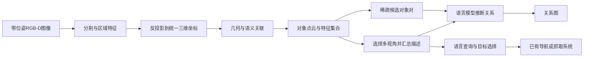

# ConceptGraphs：把多视角观测融合为可用语言查询的对象地图

> 状态：技术精读 · arXiv v1 · 未复现

## 一句话

ConceptGraphs 把带位姿的 RGB-D 图像融合成对象点云，为每个对象保存视觉特征和文字描述，再推断对象间关系，让语言模型能够从一个紧凑的三维对象集合中寻找目标并调用导航或操作系统。

## 它要解决的问题

机器人需要回答的不只是“这个像素是什么”，还包括“刚才看到的椅子在哪里”“有什么东西适合临时固定拉链”“目标是否还在原来的位置”。这些问题要求把多次观测放进同一个三维坐标系，同时保留物体身份和可查询的语义。

[ConceptFusion](https://concept-fusion.github.io/) 等方法把二维基础模型的特征投到三维点上，使地图可以响应开放词汇查询。开放词汇指推理时的文本概念不受固定训练类别表限制。逐点语义特征提供细致信息，却需要为大量相邻点保存重复的高维向量；对象之间的“位于……上”“包含”等关系，也没有自然地成为单独的数据结构。

ConceptGraphs 把表示单位改为对象。一个对象保存自己的点云、特征与描述；关系成为对象之间的边。这样既能继续访问三维几何，也能把对象概括为语言模型可以读取的短记录。[1，§I–II]

## 核心想法

方法的增量在于三类信息的结合：

1. **几何负责跨视角关联。** 同一个对象在不同图像中出现的分割区域，利用三维位置重叠与语义相似度合并。
2. **视觉语言模型负责对象描述。** 保留多个有信息量的视角，分别生成描述，再汇总成对象标签与说明。
3. **语言模型负责关系和任务推理。** 给候选对象对推断空间关系；面对自由语言任务，则从对象记录中选出合适的目标。

映射过程中使用现成 SAM、CLIP、LLaVA 与 GPT-4。论文中的训练自由，指构建这套三维表示时不再为它训练新的三维语义模型；系统仍依靠这些已经预训练的模型能力。[1，§II-D]

## 机制

### 1. 地图保存什么

时刻 \(t\) 的表示为

\[
M_t=(O_t,E_t),\qquad
o_j=(P_j,\mathbf f_j,\text{观测记录},\text{文字描述}),
\]

其中 \(P_j\) 是对象点云，\(\mathbf f_j\) 是对象级语义特征，\(E_t\) 表示关系边。点云保存形状和位置，特征用于比较图像与语言，观测记录支持选择描述视角。[1，§II-A、附录A2]

它节省的主要是语义特征存储。设场景有 \(N\) 个三维点、\(J\) 个对象，每个语义向量有 \(d\) 维：逐点表示需要约 \(Nd\) 个语义数值，对象表示需要约 \(Jd\) 个；几何点和观测记录仍要另行保存。对象级抽象的价值来自 \(J\) 通常远小于 \(N\)。

输入是一组带相机内参、深度和相机位姿的 RGB-D 图像。对分割区域中的像素 \(\mathbf u=(u,v,1)^\top\)，把深度 \(z\) 反投影，再变换到地图坐标系：

\[
\mathbf p^W=R_{WC}\bigl(zK^{-1}\mathbf u\bigr)+\mathbf t_{WC}.
\]

\(K\) 是相机内参，\((R_{WC},\mathbf t_{WC})\) 是相机到世界系的位姿。系统据此得到每个区域的局部点云，利用 DBSCAN 密度聚类去除离群点，提取 CLIP 特征，再尝试与已有对象关联。相机位姿由输入提供，几何精度也会受到位姿、深度和标定误差影响。

### 2. 如何判断新区域是不是旧对象

对当前检测 \(i\) 与地图对象 \(j\)，原论文组合两种相似度：

\[
\phi_{\rm geo}(i,j)=
\frac{\#\{\mathbf p\in P_i:\min_{\mathbf q\in P_j}\|\mathbf p-\mathbf q\|<\delta_{\rm nn}\}}
{|P_i|},
\]

\[
\phi_{\rm sem}(i,j)=\frac{\mathbf f_i^\top\mathbf f_j+1}{2},
\qquad
\phi(i,j)=\phi_{\rm geo}+\phi_{\rm sem}.
\]

特征先归一化，因此内积是余弦相似度。几何项回答“新点是否贴近旧对象”，语义项回答“它们看起来是否相似”。系统贪心选择分数最高的已有对象；超过关联阈值就合并，否则创建新对象。[1，§II-A]

**示例数值。** 假设当前分割到一把椅子：

- 与地图椅子A的点云重叠比例为0.65，特征余弦相似度为0.60，综合分数为 \(0.65+(0.60+1)/2=1.45\)。
- 与另一把相似椅子B的重叠比例为0.10，余弦相似度为0.96，综合分数为 \(0.10+(0.96+1)/2=1.08\)。

原文关联阈值为1.1，因此系统选择A。这个例子说明，几何能帮助区分同类外观；仅凭高语义相似度，仍不足以认定是同一实例。示例分数并非论文实验记录。

关联后，对象点云做并集与体素降采样，视觉特征按关联观测数更新：

\[
\mathbf f_j^{\rm new}=
\frac{n_j\mathbf f_j+\mathbf f_i}{n_j+1}.
\]

代码还会对合并后的特征重新单位化，并提供周期性去噪、过滤及重复对象合并。[2，`merge_obj2_into_obj1`；3]

### 3. 多视角如何生成一个稳定的对象描述

完成图像序列的对象融合后，系统为每个对象选择至多十个较好的视角。视角质量依据它向对象点云贡献的有效点数维护。LLaVA 为各视角生成粗描述，GPT-4 再把这一组描述总结为对象标签与一句说明；不一致的描述可以被标为无效。[1，§II-A、附录A2]

这一步有两个作用：同一对象在单个视角中被遮挡、看不清或识别错误时，其他视角可以提供补充；最终文字也比把所有图像逐一交给任务模型更紧凑。

因此，应把更新分成两层理解：**对象点云与特征随输入增量融合，论文展示的文字描述在整段序列处理后生成。** 两者的时序边界直接影响在线系统的响应速度。

### 4. 关系边怎样得到

系统先依据对象间的空间重叠构造候选连接，再用最小生成树稀疏化。最小生成树是在一个连通分量内用少量边连接节点的图结构；它把昂贵的语言模型判断限制到部分对象对，而不是对所有对象两两提问。[1，§II-B]

然后将候选对象对的包围盒位置、尺寸与对象语义交给语言模型，得到关系和解释，例如“A在B上”“A在B内”。关系把几何布局与物体常识结合起来：一个小物体出现在桌面上方，且类别是杯子，支持模型推断其与桌子的支撑关系。

公开主分支的默认提示枚举四种方向化关系与“以上都不是”，并把输出保存为图边。[4] 由此得到的是一种适合语义推理的关系假设；若用于抓取、碰撞或关节控制，还需要相应几何与物理验证。

### 5. 查询如何落到实际行动

论文比较两条查询路径。CLIP 路径把文本编码成特征，与对象特征做余弦相似度排序；LLM 路径读取对象ID、包围盒中心与尺寸、标签和描述，从中返回相关对象及解释。[1，§II-C、附录A3]

对于“盆栽”之类直接描述，视觉语义匹配已经有效。对于“能临时固定坏拉链的东西”，语言模型可以利用胶带的用途推理，比单纯寻找与“拉链”外观接近的对象更合适。选出对象后，系统把其三维位置交给已有导航或操作模块；语言目标定位与运动执行在这里是相接的两层。

### 6. 论文实际处理了哪些变化

真机物体搜索示例会先前往记忆位置，通过当前图像检查目标是否还在；若不在，则让语言模型推测可能的容器或存放位置，再继续搜索。AI2Thor 示例在预建对象地图上做平面位置与航向的粒子滤波定位，并展示删除未再观测对象、加入新对象的地图修改。[1，§III-E、§III-G]

这些示例表明对象化结构便于修订地图。但原始关联依赖几何重叠：一个物体大幅移动后，在新位置可能首先成为新对象。持续运动中的跨位置身份关联、遮挡后的身份歧义，以及对象历史状态的维护，仍需单独设计。

## 证据：哪个实验支撑哪个主张

| 主张 | 支撑实验 | 怎样理解证据 |
|---|---|---|
| 对象与关系有可用语义 | Table I：Replica场景人工评估，CG平均节点标签精确率0.71、关系边精确率0.88 | 节点按三人中至少两人认可判断；精确率不等于找到了所有物体或全部关系 |
| 对象特征可用于开放词汇分割 | Table II：CG的mAcc为40.63，ConceptFusion为24.16；但F-mIoU为35.95，低于ConceptFusion+SAM的38.70 | 不同指标给出不同排序，支持具有竞争力，而非所有分割指标全面最优 |
| 语言推理特别帮助否定与用途查询 | Table III：Replica否定查询R@1，LLM为0.80，CLIP为0.26；用途查询为0.57与0.43 | 两者是在同一对象表示上使用不同检索方式，增益包含文字描述和语言推理作用 |
| 直接描述不一定需要LLM | Table III：Replica描述查询R@1为0.61与0.59；R@2反而是CLIP更高 | 复杂模型的优势取决于问题类型，不能据此统一替代向量检索 |
| 可以连接真机任务 | §III-D–F及视频：Jackal目标搜索、可推物体通行，Spot开放词汇抓放 | 展示接线与任务可行性，论文没有给出这些真机任务的大规模统一成功率 |
| 对象结构支持地图修订 | §III-G：AI2Thor中展示3自由度定位与增删对象 | 是特定定位/重建示例，没有构成连续动态身份跟踪的完整评测 |

这里的R@k表示正确对象是否出现在前k个检索结果中。它测目标检索，不测机器人是否走到目标、能否抓稳或是否安全通过。

## 局限与后续

**语义错误会沿任务链传播。** 对象描述主要依靠视觉语言模型；小物体、薄结构、遮挡和错误掩码会影响点云、特征与标签。若任务恰好依赖一个识别错误的关键对象，后续语言推理再合理也难以挽回。[1，§III-H]

**地图维护需要区分静态融合与真实运动。** 点云并集和平均特征适合累计一个相对静止对象的多视角证据；运动、拆分、容器开合会改变几何及关系。下一步应把观测时间、可见性和身份假设分开保存，让新证据能够改变旧事实，而非持续叠加。

**关系图仍是不完整的抽象。** 稀疏候选降低计算，但可能遗漏对任务有用的对象对；语言推断关系也需要明确坐标系、观测依据与不确定性。测得的距离、推断的支撑关系、常识上的“通常放在”适合分别表示。

**紧凑表示没有消除推理成本。** 多视角描述、汇总、关系生成和任务查询均可能调用大模型。原论文明确把计算和商业模型调用费用列为局限。一个面向实时机器人的实现，需要分别测映射、描述、关系更新与任务查询的延迟，并记录哪些模型结果能够安全复用。

对场景编译研究，这篇论文提供了一个具体参照：从传感器观测产生可被语言模型消费的对象记录已经可行。进一步值得验证的是，证据、时间和有效性如何进入接口，以及任务收益分别来自对象化、视觉保留、关系边还是更强的语言推理。

## 批注

**易误读**

- ConceptGraphs接收带位姿RGB-D观测；它的对象融合模块不能替代输入相机位姿、标定与深度估计。[1，§II-A]
- 论文的节点caption和关系生成在对象地图形成后进行；增量点云融合不等于全部语义内容已经实时刷新。[1，§II-A–B]
- 主分支默认关系提示只枚举“a on b”“b on a”“a in b”“b in a”“none of these”。论文所说可扩展关系类型，是接口潜力，不能直接当作该实现已支持任意关系。[4，L710–L727]
- Table III的查询提示主要列对象几何与caption字段，附录A5还明确真机导航实验只使用对象集合\(O_T\)；这些实验没有隔离关系边的收益，不能把LLM相对CLIP的提升全部归因于显式图边。[1，附录A3、A5]
- 原文关联分数使用重标定后的余弦相似度；所读代码的`aggregate_similarities`采用可调权重的原始余弦与空间分数，其阈值不能照搬原论文数字。[3]

**与其他论文的关联**

- [ConceptFusion](https://concept-fusion.github.io/)提供二维基础特征融合到三维的直接基础。ConceptGraphs主要改变语义存储与查询单位，由逐点特征转向对象实例，并加入对象描述与关系。[1，§I、Table II]
- [HOV-SG](https://hovsg.github.io/)把语义空间进一步组织为楼层、房间与对象层级，适合比较“对象间关系”与“空间包含层级”对导航检索的不同作用。
- [3D-Mem](../arxiv-2411.17735/README.md)保留可检索的视觉快照，适合对照纯对象标签/描述在细粒度视觉问题中的信息损失；对象结构与原图证据可以有不同职责。

**未核实 / 待验证**

- 原论文明确把更完整的时间动态列为后续方向；尚无本次核验范围内的连续多目标身份、运动预测或关系失效统一指标。
- 官方README提到`ali-dev`实时重构，但本文仅抽查固定main提交的对象映射及关系生成路径，未核实该分支的端到端性能，也未运行模型、API或机器人实验。
- 本文核对arXiv v1正文、附录及项目PDF；官方项目标注ICRA 2024，尚未逐项比较IEEE最终出版版与预印本的全部差异。

**参考文献与实现**

1. [论文v1](https://arxiv.org/abs/2309.16650v1)；[原文PDF](https://arxiv.org/pdf/2309.16650v1)；[官方项目与演示](https://concept-graphs.github.io/)。
2. [官方对象融合与特征单位化](https://github.com/concept-graphs/concept-graphs/blob/93277a02bd89171f8121e84203121cf7af9ebb5d/conceptgraph/slam/utils.py#L178-L220)。
3. [官方空间/语义关联实现](https://github.com/concept-graphs/concept-graphs/blob/93277a02bd89171f8121e84203121cf7af9ebb5d/conceptgraph/slam/mapping.py)；[增量映射与周期后处理](https://github.com/concept-graphs/concept-graphs/blob/93277a02bd89171f8121e84203121cf7af9ebb5d/conceptgraph/slam/cfslam_pipeline_batch.py#L270-L301)。
4. [官方候选边与关系提示](https://github.com/concept-graphs/concept-graphs/blob/93277a02bd89171f8121e84203121cf7af9ebb5d/conceptgraph/scenegraph/build_scenegraph_cfslam.py#L621-L727)。
