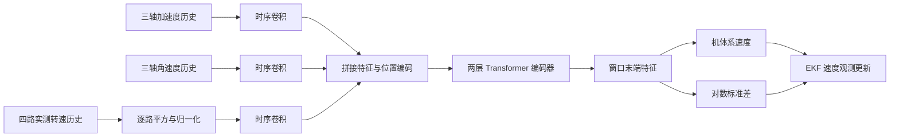

# AI-IO：用旋翼转速补足惯性速度估计的物理条件

> 状态：技术精读 · arXiv v1 · 未复现

## 一句话

AI-IO 从四旋翼的受力关系出发，把四个旋翼的实测转速与 IMU 历史共同输入小型网络，预测机体系速度及其不确定性，再作为 EKF 的速度观测，减轻惯性积分漂移。

## 它要解决的问题

加速度计测量比力，即单位质量受到的非重力作用力；陀螺仪测量角速度。利用两者估计姿态、把加速度转换到世界坐标系，再积分得到速度和位置，是惯性里程计的基本流程。困难在于微小偏置会持续累积：一个恒定的加速度误差，经过一次积分成为随时间增长的速度误差，经过两次积分成为增长更快的位置误差。

学习型惯性里程计采用另一条约束：根据过去一段 IMU 信号，直接预测当前速度，再利用它校正积分结果。[AirIO](https://arxiv.org/abs/2501.15659) 已强调机体系表示的重要性。机体系速度描述“沿机头、机身侧向和机身竖直方向运动多快”，学习目标与飞机的自身运动更直接相关。

AI-IO 进一步问：**如果速度与飞机受到的空气阻力有关，那么只输入 IMU，是否遗漏了决定阻力大小的变量？**

四旋翼的阻力不只取决于飞行速度，还受到旋翼转速影响。同一组加速度计读数，在不同旋翼状态下可能对应不同速度。论文的核心贡献，是先从受力模型确定应测什么，再设计网络学习输入与速度之间的映射，而不是只更换一个更大的时序模型。[1，§III-A]

## 核心想法与增量

相对 AirIO，AI-IO 的增量可以分成三层：

- **输入层**：加入电子调速器 ESC 回传的四路旋翼转速。ESC 是控制无刷电机并回传运行状态的电子设备。
- **时序模型层**：分别对加速度、角速度、旋翼转速做一维卷积，再用 Transformer 汇总历史，输出窗口末端的速度和不确定性。
- **系统层**：把速度预测接入误差状态 EKF，并在低算力机载计算机上测试完整估计链。

其中最值得借鉴的是第一层：传感器和输入的选择受到动力学关系指导。论文的旋翼输入消融，直接检验了这个选择是否提供额外信息。卷积和 Transformer 则承担噪声处理、时序特征提取及隐式映射学习。[1，§III、Fig.4]

## 机制

### 1. 从加速度计读数连接到推力和阻力

设旋转矩阵 \(R\) 把机体系向量变换到世界系，\(\mathbf a^W\) 是世界系运动加速度，\(\mathbf g^W\) 是重力，加速度计读数可写成

\[
\tilde{\mathbf f}^{B}=R^\top(\mathbf a^W-\mathbf g^W)+\mathbf b_a+\mathbf n_a.
\]

\(\mathbf b_a\) 是缓慢变化的加速度计偏置，\(\mathbf n_a\) 是噪声。按照牛顿定律，把重力单独列出后，有

\[
m\mathbf a^W=m\mathbf g^W+R(\mathbf F_T^B+\mathbf F_D^B),
\qquad
\tilde{\mathbf f}^{B}=\frac{\mathbf F_T^B+\mathbf F_D^B}{m}+\mathbf b_a+\mathbf n_a.
\]

\(\mathbf F_T\) 为旋翼推力，\(\mathbf F_D\) 为气动阻力。这条关系解释了为什么 IMU 信号中会包含速度线索：速度改变气动力，气动力改变加速度计测到的比力。

因此，匀速也可能产生有用信号。飞机保持非零速度时，要以推力和姿态调整平衡空气阻力；世界系加速度接近零，并不意味着机体系各轴比力没有结构。

### 2. 旋翼转速如何改变同一读数对应的速度

论文用平均转速平方

\[
u_r=\omega_m^2=\frac14\sum_{i=1}^{4}\omega_i^2
\]

概括旋翼运行状态。其式(2)的横向关系为

\[
\tilde f_x=-\lambda_xu_rv_x-k_1v_x-k_2v_x^2+b_{a_x}+n_{a_x},
\]

侧向有同型表达，竖直方向则包含总推力项

\[
\tilde f_z=4\alpha u_r-k_5v_z-k_6v_z^2+b_{a_z}+n_{a_z}.
\]

这里的系数吸收了机体、桨叶、质量尺度及空气条件等因素。横向第一项表示随旋翼状态变化的诱导阻力，后两项表示机体气动阻力；竖直方向先有旋翼总推力，再叠加速度相关阻力。[1，式(2)]

**示例数值：相同加速度读数，为何还需要转速。** 为便于手算，先忽略二次阻力、偏置和转动，把单轴模型写成

\[
\tilde f_x=-c(q)v_x,\qquad c(q)=0.4+0.6q\;\mathrm{s}^{-1},
\]

其中 \(q=u_r/u_{\rm ref}\) 是无量纲的转速平方比值。这些系数仅用于说明机制。

若测到 \(\tilde f_x=-2\,\mathrm{m/s^2}\)：

- 当 \(q=1\) 时，\(c=1\,\mathrm{s}^{-1}\)，对应 \(v_x=2\,\mathrm{m/s}\)。
- 当 \(q=2\) 时，\(c=1.6\,\mathrm{s}^{-1}\)，对应 \(v_x=1.25\,\mathrm{m/s}\)。

知道转速，就能区分“阻力系数较小、速度较大”和“阻力系数较大、速度较小”这两种情况。在参数稳定、气流条件明确的局部模型中，这会减少速度估计的歧义。

**电机模型在这里扮演什么角色？** AI-IO 直接使用 ESC 测得的转速，从而获得推力和诱导阻力的重要状态量。官方预处理代码读取四个电机的 RPM，网络分别平方并归一化。[2，`our2.py`；3，`IMUTransformerWithModality.forward`]

从油门到转速，还会受到电池、电机、螺旋桨负载和响应滞后影响；实测转速把这些作用后的运行状态带入了估计。AI-IO 的实现因此重点学习“IMU＋转速历史→速度”，而不是输出电机电气参数、桨叶气动系数或电机转速微分方程。

机身转动也会改变速度的机体系表达，陀螺仪历史为模型提供转弯和姿态变化的线索。完整网络同时读取三类信号，学习它们在一段时间内如何共同变化。

### 3. 网络具体怎样处理十个输入通道

官方数据加载器拼接

\[
\mathbf x_t=[\tilde{\mathbf f}_t^B,\tilde{\boldsymbol\omega}_t^B,
\mathrm{RPM}_{1,t},\ldots,\mathrm{RPM}_{4,t}]\in\mathbb R^{10},
\]

监督目标由真值姿态和世界系速度得到：\(\mathbf v_t^B=R_t^\top\mathbf v_t^W\)。[2，`datasets.py`]

以 README 的一秒、100 Hz 输入为例，一个窗口包含100个时刻。三路输入各经过核宽为5的一维卷积，各输出16维特征，拼成48维的时序表示；无填充卷积后，时间长度变为96。加入位置编码后，两层、八头 Transformer 编码器在窗口内部进行信息融合，最后只取末端 token，经两个独立线性头输出三维速度和三维不确定性参数。[3]

卷积擅长提取短时局部模式，注意力机制则让末端预测利用整个历史窗口。窗口内各位置可以互相注意，而所有输入都来自当前和过去，因此这种窗口融合能够用于末端在线预测。

转速平方的归一化非常实际：RPM 数值远大于典型 IMU 读数，平方后尺度差异更大；减均值、除标准差，可以降低不同模态尺度对学习的干扰。官方实现保留四路转速平方，没有在输入端先压成一个均值。[3]

### 4. 为什么还要预测不确定性

网络先学习速度，再学习预测误差的尺度。官方默认训练前期使用 Huber 损失，小误差平方惩罚、大误差线性惩罚；到指定训练轮次后切换为高斯负对数似然。[4]

代码中的第二个输出头预测 \(s_j=\log\sigma_j\)，协方差为

\[
\Sigma=\operatorname{diag}(e^{2s_x},e^{2s_y},e^{2s_z}),
\qquad
\mathcal L_{\rm NLL}=\sum_j\left[\frac{(v_j-\hat v_j)^2}{2e^{2s_j}}+s_j\right].
\]

第一项要求误差与预测方差相匹配；第二项约束模型不能无限放大方差来逃避误差。这样获得的不确定性进入滤波器，决定这次网络观测值得信任多少。

### 5. EKF 怎样把预测速度接回惯性积分

滤波状态包含姿态 \(R\)、世界系速度 \(\mathbf v\)、位置 \(\mathbf p\) 和两种 IMU 偏置。高频 IMU 负责传播，例如

\[
R_{k+1}=R_k\operatorname{Exp}((\tilde{\boldsymbol\omega}_k-\mathbf b_g)\Delta t),
\]

\[
\mathbf v_{k+1}=\mathbf v_k+
[\mathbf g^W+R_k(\tilde{\mathbf f}_k-\mathbf b_a)]\Delta t.
\]

网络给出机体系速度观测 \(\mathbf z=\hat{\mathbf v}_{\rm net}^{B}\)，滤波器根据当前状态预测的对应量是 \(h(\mathbf X)=R^\top\mathbf v\)。两者差值形成创新：

\[
\mathbf r=\mathbf z-R^\top\mathbf v,
\qquad
K=PH^\top(HPH^\top+\Sigma)^{-1}.
\]

\(P\) 描述状态估计的不确定性，\(H\) 把状态误差映射到观测误差。网络方差越大，滤波器通常越少依赖这次速度观测。姿态与偏置也能通过状态间的交叉协方差得到修正。[1，§III-D；5]

**示例数值：**只看一维速度，惯性预测为 \(2\,\mathrm{m/s}\)，方差为 \(0.25\)；网络测得 \(1.4\,\mathrm{m/s}\)，标准差为 \(0.2\,\mathrm{m/s}\)。则 \(K=0.25/(0.25+0.04)\approx0.862\)，修正速度约为 \(1.483\,\mathrm{m/s}\)。若网络报告更大方差，修正量会更小。这说明速度头与不确定性头分别回答“往哪修”和“修多少”。

### 6. 数据处理怎样影响结论

作者自采数据用 VICON 提供位置、姿态和速度真值，包含不同速度的手动飞行，以及圆形、八字和随机等低速自主飞行。手动数据按7:1.5:1.5分训练、验证、测试，低速自主飞行加入测试，用于检查运动模式变化。[1，§III-C、§IV-C]

公开预处理实现先将 IMU 重采样到100 Hz，再把转速和真值插值到共同时间轴，进行离线 IMU 偏置校正，最后在每条序列内部按时间先后划分三段。数据加载器在每段内部构造窗口。[2]

因此，这套测试同时包含“同一手动飞行记录中未参与训练的时间段”和“其他自主飞行轨迹”。跨新飞行器、跨室外风场、跨电机桨叶的结论，需要另外设计整段留出和跨硬件测试。

## 证据：哪个实验支撑哪个主张

AVE 是三维速度误差的 RMSE，ATE 是位置误差的 RMSE；越小越好。下面保留决定方法判断的比较，均为作者报告。[1，§IV；6]

| 主张 | 支撑实验 | 怎样读这组证据 |
|---|---|---|
| 转速提供了额外速度信息 | Fig.4(a)：加入转速后，平均机体系速度预测误差降低36.9% | 直接支持输入设计有用；它检验的是特定数据分布下的预测误差 |
| 时序建模和局部特征有独立价值 | Fig.4(a)：Transformer 相对 TCN 降低误差22.4%；加入 CNN 前端降低23.9% | 是不同消融对照，不能把三个百分比直接相加 |
| 在 DIDO 上优于同类网络 | Table I：AI-IO Net / AirIO Net 平均 AVE 为0.331 / 0.564 m/s，ATE 为2.636 / 3.905 m | Net 两列使用真值姿态把机体系速度转到世界系，主要比较速度网络 |
| 优势延伸到估计姿态参与的滤波链 | Table I：AI-IO EKF / AirIO EKF 平均 AVE 为0.371 / 1.182 m/s，ATE 为3.876 / 5.972 m | AI-IO EKF 优于 AirIO EKF，但仍比自己的 GT 姿态 Net 结果差，姿态误差依然重要 |
| 在作者自采数据上有效 | Table II：AI-IO Net / AirIO Net 平均 AVE 为0.237 / 0.556 m/s，ATE 为1.809 / 2.559 m | 同样使用真值姿态，支持该数据协议下的网络比较 |
| 小型机载计算机能够运行 | §IV-D：Radxa Zero3W 上网络平均推理8.9 ms，系统报告 EKF 20 Hz | 是指定部署条件的平均推理时间与系统频率，需要分别引用 |
| 换机体后少量数据可帮助适配 | Fig.9：改变质量和外观后，用7分钟数据微调，比仅用少量数据从头训练收敛更好 | 支持该次迁移的预训练价值，尚未建立任意四旋翼的统一适配保证 |

低照度实飞比较还展示了一个系统用途：在关闭照明后，依赖相机的 T265 VIO 发生退化，AI-IO 继续利用 IMU 和转速估计。这个实验支撑它作为视觉退化时的运动估计补充。[1，Fig.1、§IV-D]

## 局限与后续

**首先是空气速度与地面速度之间的区别。** 气动力实际依赖相对气流速度。设世界系风速为 \(\mathbf w^W\)，则空气相对速度为 \(R^\top(\mathbf v^W-\mathbf w^W)\)。论文明确采用无风条件，把它与机体系地面速度等同。室外有风时，风和自身运动可能相互混淆；扩展方向是联合风估计，或结合视觉、LiDAR、GNSS等外部速度约束。

**其次是机体变化。** 质量、桨叶、载荷和气流条件变化，会改变速度与比力、转速的映射。微调实验提供了适配证据，更系统的检验应分别改变质量、桨叶、电池与风场，记录何时需要重新训练、何时预测方差能够提前反映失配。

**再者是物理解释的深度。** 方程指导了输入选择，但公开网络没有显式求解气动参数，也没有在训练损失中强制满足受力方程。物理残差约束、可辨识参数层和与多传感器估计器的联合标定，是可以继续分离验证的方向。

**对学习型 IMU 研究，最有价值的迁移是方法论。** 先问“目标量与现有观测的物理关系还缺哪个变量”，再比较添加该测量、修改网络和调整滤波三者各自的收益。四足机器人的接触状态、编码器或力觉，与四旋翼的转速扮演着相似的额外条件角色，但应依据各自的运动与受力模型选择。

## 批注

**易误读**

- “惯性里程计”描述其主要估计链；AI-IO 的完整输入还包括四路 ESC 转速，不能据此给只有 IMU、没有转速记录的数据承诺同等结果。[1，§III-A；2]
- Net 轨迹评测使用真值姿态；EKF 入口当前默认使用真值初始姿态、速度、位置及离线标定偏置。引用时应分开“持续使用GT姿态”和“仅GT初始化”这两种条件。[1，Table I/II脚注；6；7]
- 论文式(4)把 \(\Delta t\) 排在旋转指数外；正确离散传播应把角增量放进指数，官方代码使用 `dtheta=(gyr-bias)*dt`。本文采用这个实现一致的形式。[5，`propagate_rvt_and_jac`]
- 论文式(9)协方差更新右侧出现 \((I-KH)^{-1}\)；标准 Joseph 形式是 \((I-KH)P(I-KH)^\top+K\Sigma K^\top\)。官方代码采用 \(P-KHP\) 后对称化，没有实现该逆矩阵写法。[1，式(9)；5，`apply_update`]
- §IV-A 解释 ATE/RTE 时把位置误写为速度；单位、实验用途及官方 `error_analyze.py` 表明位置与速度分别计算 RMSE。公开相对误差脚本采用固定499个采样间隔，采样频率变化时应重新核对它与“5秒”的对应关系。[8]
- 当前 `EmpiricalNormalization.update()` 在 `eval()` 时也会被调用；批量测试与逐次在线输入会以不同批次更新转速统计量。复现时应明确使用冻结统计还是在线自适应，并保持比较协议一致。[3，L294–L359]

**与其他论文的关联**

- [AirIO](https://arxiv.org/abs/2501.15659) 是直接性能对照：AI-IO 保留机体系速度估计思路，增加旋翼运行状态。比较两者能区分“坐标表示改进”与“物理输入补全”这两种增量。[1，§II-B、Table I]
- [DIDO](https://arxiv.org/abs/2203.03149) 将四旋翼动力学、网络观测与两级 EKF 联系起来；AI-IO 更集中地围绕转速和比力学习机体系速度，并使用 DIDO 数据做验证。两者适合对比显式动力学估计和隐式速度映射的取舍。[1，§II-B、§IV-C]
- [TLIO](https://github.com/CathIAS/TLIO) 展示“网络预测＋不确定性＋惯性滤波”的组合；AI-IO 的损失和代码也承接了这类基础。其新意应定位到四旋翼所需观测及相应时序估计，而不是把神经网络观测接入 EKF 这一通用框架。[1，参考文献14；官方仓库致谢]

**未核实 / 待验证**

- 论文式(2)把二次阻力写成 \(-k_2v_x^2\) 等形式，未完整说明正反方向的符号处理；正文另加 \(-2\boldsymbol\omega\times\mathbf v\) 的“科里奥利”项，也未给出完整坐标推导。二者若要成为独立物理求解器，应先核对原始气动文献与参考系约定；本文数值例仅使用局部线性简化。
- 转速提升预测的消融，并不替代包含未知偏置、未知风、未知气动系数的完整系统可观测性分析；尚需检验长期航向和位置漂移、不确定性校准及分布外拒绝能力。
- 本次核对论文全部章节、项目PDF、图表及固定提交代码；未下载并运行权重和完整数据，未复现误差、机载推理时间或实飞控制。项目页标注 ICRA 2026，尚未独立核对出版社最终录用版的全部内容。

**参考文献与代码位置**

1. [论文正文 v1](https://arxiv.org/html/2603.00597v1)；[论文PDF](https://arxiv.org/pdf/2603.00597v1)；[官方项目](https://csfalpha.github.io/AI-IO.github.io/)。
2. 官方数据：[预处理](https://github.com/SJTU-ViSYS-team/AI-IO/blob/5866134d5e9e20c082a32f06a59e99abb9049a15/src/learning/data_management/prepare_datasets/our2.py)；[输入与监督目标](https://github.com/SJTU-ViSYS-team/AI-IO/blob/5866134d5e9e20c082a32f06a59e99abb9049a15/src/learning/data_management/datasets.py#L61-L83)。
3. 官方网络：[模态卷积、转速平方与归一化、末端预测](https://github.com/SJTU-ViSYS-team/AI-IO/blob/5866134d5e9e20c082a32f06a59e99abb9049a15/src/learning/network/model.py#L217-L359)；[主干默认配置](https://github.com/SJTU-ViSYS-team/AI-IO/blob/5866134d5e9e20c082a32f06a59e99abb9049a15/src/learning/network/model_factory.py)。
4. 官方损失：[Huber与对数标准差NLL](https://github.com/SJTU-ViSYS-team/AI-IO/blob/5866134d5e9e20c082a32f06a59e99abb9049a15/src/learning/network/losses.py)；[训练默认项](https://github.com/SJTU-ViSYS-team/AI-IO/blob/5866134d5e9e20c082a32f06a59e99abb9049a15/src/main_learning.py#L40-L64)。
5. 官方滤波：[状态传播与观测更新](https://github.com/SJTU-ViSYS-team/AI-IO/blob/5866134d5e9e20c082a32f06a59e99abb9049a15/src/filter/python/src/scekf.py)。
6. 官方评测：[使用GT姿态积分网络速度](https://github.com/SJTU-ViSYS-team/AI-IO/blob/5866134d5e9e20c082a32f06a59e99abb9049a15/src/learning/test_model_net.py#L26-L54)。
7. 官方入口：[GT初始化与离线标定默认开关](https://github.com/SJTU-ViSYS-team/AI-IO/blob/5866134d5e9e20c082a32f06a59e99abb9049a15/src/main_filter.py#L82-L87)。
8. 官方指标：[位置、速度和相对RMSE实现](https://github.com/SJTU-ViSYS-team/AI-IO/blob/5866134d5e9e20c082a32f06a59e99abb9049a15/src/learning/utils/error_analyze.py#L4-L60)。
